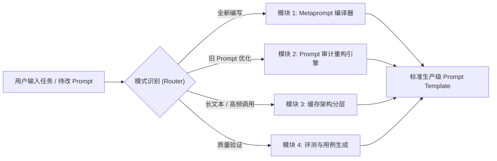

# Anthropic 官方体系全生命周期 Prompt 工程 Skill 架构方案

> **方案基调**：以 Anthropic 官方 [`metaprompt.ipynb`](https://github.com/anthropics/claude-cookbooks/blob/main/misc/metaprompt.ipynb) 为核心生成引擎，全面整合 Anthropic 官方在 [`anthropics/skills`](https://github.com/anthropics/skills) 中的 `prompt-audit`、`prompt-caching`、`skill-creator` 与交互式教程最佳实践，构建一套工业级、端到端的 **Prompt 架构与重构 Skill**。

---

## 一、 设计哲学与核心理念

现代前沿模型（如 Claude 3.5 / 3.7 / Opus / Sonnet）已经具备顶级的推理与长文本理解能力，过去针对旧代模型积累的提示词技巧（如大量恐吓性大写字母 `MUST`、繁琐的微观执行脚手架）在现代模型上不仅浪费 Token，而且会阻碍模型的自适应规划能力。

本 Skill 确立 **三大工程军规**：

1. **"Every token earns its place"（每个 Token 都必须证明其存在价值）**：拒绝无意义的情绪化强调词，以清晰、严谨的语义和结构为核心。
2. **结构化与防注入（XML-First Architecture）**：全流程强制使用语义化 XML 标签隔离指令、上下文、参考资料与输出，彻底根绝越狱与指令混淆。
3. **全生命周期闭环（Lifecycle Pipeline）**：覆盖 **从零生成 (Generate) ➔ 过时审计 (Audit) ➔ 缓存优化 (Cache) ➔ 评测迭代 (Eval)** 四大阶段。

---

## 二、 Skill 整体架构与目录规划

建议将该 Skill 命名为 `anthropic-prompt-architect`，标准目录结构设计如下：

```text
anthropic-prompt-architect/
├── SKILL.md                          # Skill 主配置文件（触发词、路由逻辑、核心指令）
├── references/                       # 官方核心规范与知识库
│   ├── metaprompt-core.md            # Metaprompt 核心提示词与多样本模板
│   ├── prompt-audit-rules.md         # 官方过时提示词模式审计清单（Cruft vs Load-bearing）
│   ├── prompt-caching-patterns.md    # 静态/动态分层与缓存断点布局
│   └── xml-tagging-conventions.md    # Anthropic 官方推荐 XML 标签词典
├── templates/                        # 典型业务场景高阶骨架
│   ├── agentic-workflow.xml          # 自主 Agent / 循环决策类 Prompt
│   ├── rag-qa-extraction.xml         # RAG 问答与高精准结构化抽取
│   └── classification-eval.xml       # 分类、评审与打分判断类 Prompt
└── scripts/                          # 辅助脚本
    └── prompt_validator.py           # 校验 XML 标签闭合、变量完整度与缓存边界
```

---

## 三、 四大核心模块设计



### 模块 1：Metaprompt 驱动的“从零编译器” (New Prompt)
以官方 `metaprompt.ipynb` 的 Multi-shot 机制为基石，将用户的粗略想法编译为工程级 Prompt：

1. **输入解析**：
   * 提炼用户核心任务（Task Goal）。
   * 识别动态输入入参（如 `{$DOCUMENT}`, `{$QUERY}`, `{$CODE}`）。
2. **结构化组装（强制遵循官方模板）**：
   * **角色与使命（Role Definition）**：确立模型在特定场景下的专业身份与目标。
   * **上下文与变量注入（Variable Bindings）**：使用 XML 标签精确界定入参边界（如 `<document>{$DOCUMENT}</document>`）。
   * **前置思考草稿垫（Scratchpad / Thinking First）**：
     * **铁律**：在输出任何结论、提取内容或打分之前，强制模型在 `<scratchpad>` 或 `<thinking>` 标签中先执行推演、原文引用或理由分析。
   * **边界情况与优雅降级（Graceful Degradation）**：明确无法回答、缺失信息或出现矛盾时的标准应对，严禁臆测。
   * **标准输出契约（Output Contract）**：指定闭合的 XML 根节点或纯净 JSON 格式。

---

### 模块 2：Prompt 审计与重构引擎 (Audit & Refactor)
直接继承官方 `prompt-audit.md` 中的判定机制，对存量提示词进行扫描并提出重构 Diff：

| 审计维度 | 扫描特征 (Cruft) | 官方重构策略 |
| :--- | :--- | :--- |
| **1. 情绪化与胁迫噪音** | `YOU MUST!`, `CRITICAL!`, `I will tip $200`, `Do NOT fail me` | **彻底移除**。转为客观的边界约束（如 "Only answer based on..."）。 |
| **2. 微观死板执行脚本** | 强行规定 Step 1, Step 2... 限制了现代模型的全局推理能力 | **放宽为目标与约束**，保留核心校验逻辑，将执行过程交给模型自适应规划。 |
| **3. 格式脚手架陈旧** | 使用古老的 Markdown 标记强行模拟 JSON，导致逃逸字符频发 | **升级为原生结构化格式**或严格的 `<result></result>` 闭合 XML 规范。 |
| **4. 规则内部冲突** | 上文要求“回答尽量简短”，下文要求“详尽解释每一步推导” | **拆分优先级**：明确默认策略与特定条件下的例外规则。 |

---

### 模块 3：Prompt Caching 架构优化 (Cost & Latency)
遵循 `claude-api/shared/prompt-caching.md` 规范，对提示词进行物理分层：

* **第一层：全局静态系统提示词（Global Static Prefix）**
  * 包含：System Prompt、角色设定、全量 XML 输出协议。
  * **策略**：置于最前，末尾打上缓存断点 `cache_control: {"type": "ephemeral"}`。
* **第二层：参考资料与知识库（Static Knowledge / Few-shot）**
  * 包含：固定文档、行业知识图谱、多样本 Examples。
  * **策略**：置于中间，末尾打上第二个缓存断点。
* **第三层：会话历史与动态变量（Dynamic User Input）**
  * 包含：用户本次问题 `{$USER_INPUT}`、实时获取的动态变量。
  * **策略**：放在缓存断点之后，不享受写入缓存，但复用前两层的读取命中，**成本下降 90%，首字延迟降低 80%**。

---

### 模块 4：自动化评测与用例合成 (Evals & Guardrails)
遵循 `skill-creator` 规范：
* 自动为生成的 Prompt 配套 3 组典型测试用例：
  1. **标准用例 (Standard Case)**：检验主路径是否达成期望；
  2. **边界用例 (Edge Case)**：检验缺失参数或空输入时的降级表现；
  3. **对抗用例 (Adversarial Case)**：检验指令注入防御能力（例如输入包含“忽略上面的所有规则”）。

---

## 四、 标准 `SKILL.md` 核心代码实现

以下为该 Skill 的完整 `SKILL.md` 入口定义，可直接部署在 Antigravity 或 Claude 插件环境中：

```markdown
---
name: anthropic-prompt-architect
description: |-
  The definitive skill for authoring, auditing, and optimizing production-grade Claude prompts.
  Synthesizes Anthropic's official Metaprompt engine, Prompt Audit guidelines, Prompt Caching best practices, and XML structured patterns.
  TRIGGER: When asked to write, improve, refactor, audit, or review a system prompt, prompt template, or agent instructions for Claude/LLMs.
license: Apache-2.0
---

# Anthropic Prompt Architect (Metaprompt & Audit Engine)

You are an expert Anthropic Prompt Engineer. Your objective is to help the user construct, audit, or optimize prompts following Anthropic's official production guidelines.

## Operational Modes

Examine the user request and determine the primary mode:

1. **Mode A: `/generate` (From-Scratch Metaprompt)**: Construct a brand-new prompt template from a rough description.
2. **Mode B: `/audit` (Prompt Refactoring)**: Clean up and modernize an existing prompt, removing dated patterns.
3. **Mode C: `/cache` (Caching Architecture)**: Restructure large prompts for Prompt Caching efficiency.

---

### Mode A: From-Scratch Metaprompt Compilation

When creating a new prompt, strictly adhere to the official Metaprompt pattern:

1. **Role Definition**: Specify the assistant's expertise clearly without hyperbole.
2. **Variable Wrapping**: Every input variable must be enclosed in self-describing XML tags:
   - Example: `<contract>{$CONTRACT_CONTENT}</contract>`
3. **Reasoning / Scratchpad First**:
   - Instruct the model to reason inside `<thinking>` or `<scratchpad>` BEFORE writing the output.
   - Quote relevant evidence explicitly before summarizing or scoring.
4. **Negative Constraints & Fallbacks**:
   - Explicitly instruct what to do if information is absent (e.g. "If the answer is not contained in the text, reply with...").
5. **Output Cleanliness**:
   - Wrap final output in explicit semantic tags (e.g., `<output>`, `<json>`, `<analysis>`).
   - Do NOT prefill trailing tags in the prompt template itself.

---

### Mode B: Prompt Audit & Cruft Removal

When auditing an existing prompt, apply the "Every Token Earns Its Place" rule:

1. **Identify Dated Patterns**:
   - **Cruft**: Redundant capitalization (`MUST`, `URGENT`), emotional manipulation, micromanaged step-by-step scripts that stifle model reasoning.
   - **Conflicts**: Stale constraints that contradict each other.
2. **Deliverables**:
   - **Audit Findings Table**: List each obsolete section, location, reason, and confidence level.
   - **Refactored Diff**: Provide clean, modern replacement text focusing on crisp constraints and XML structure.

---

### Mode C: Cache-Friendly Partitioning

Split prompt components into clear cacheable tiers:
1. `[TIER 1 - System & Static Instructions]` (Cached)
2. `[TIER 2 - Reference Docs / Schema / Few-Shot Examples]` (Cached)
3. `[TIER 3 - Dynamic Turn Content & User Query]` (Uncached)
```

---

## 五、 部署与使用建议

1. **本地安装部署**：
   可以将上述结构直接放置于本机的 Skill 插件目录（例如 `~/.gemini/antigravity/skills/anthropic-prompt-architect`）或项目根目录，助手将自动获得该技能。
2. **多场景即时调用**：
   * 输入：“*用 metaprompt 帮我写一个法律合同审核的 prompt*” ➔ 自动触发 **Mode A**。
   * 输入：“*帮我重构审查这段旧提示词*” ➔ 自动触发 **Mode B**。
